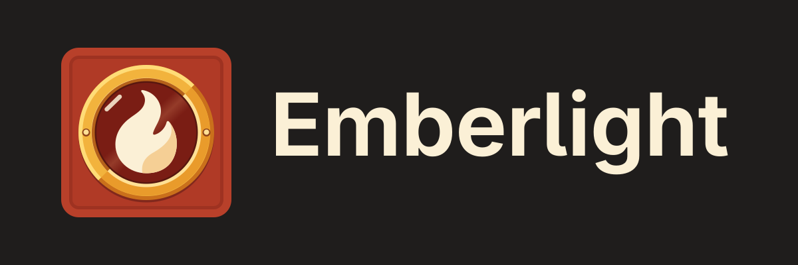

# Emberlight



*Formerly "Emrion Shaders". Version 0.1.0-alpha.1, see [CHANGELOG.md](CHANGELOG.md).*

Emberlight is a Fabric and NeoForge mod for Minecraft Java **26.3** that runs OptiFine/Iris shaderpacks on Minecraft's new **Vulkan**
renderer. Iris only works on OpenGL; Emberlight fills that gap.

On top of the pack it can add:

- **hardware ray tracing** (Complementary packs): RT shadows, reflections, refraction, caustics, AO, block-light shadows and
  global illumination, in a *Faithful* or an *RTX* style,
- **upscaling** with AMD FSR 3.1, NVIDIA DLSS or Intel XeSS (Windows),
- **frame generation** with AMD FSR 3 or NVIDIA DLSS.

When you select a pack, Emberlight converts it once into SPIR-V shaders and a fixed frame plan and caches the result. After
that it renders through Minecraft's own Vulkan backend, with every pipeline built at load time, so there is no shader stutter.

**This is an alpha.** Expect bugs and keep backups of your worlds. It has been tested on one machine (NVIDIA RTX 4070 Ti, Linux).

## Requirements

| | |
|---|---|
| Minecraft | Java Edition 26.3 |
| Loader | Fabric Loader 0.20.1 or newer, Fabric API |
| Graphics API | Vulkan: *Options → Video Settings → Graphics API → Prefer Vulkan*, then restart. On OpenGL the mod stays inactive and tells you so |
| Sodium | required, **exactly 0.9.4-beta.2** |
| Ray tracing | a GPU with `VK_KHR_ray_query` (NVIDIA RTX, AMD RX 6000 or newer); only tested on an RTX 4070 Ti |
| FSR upscaling / frame generation | any Vulkan GPU |
| DLSS upscaling | an NVIDIA RTX GPU; NVIDIA's model files are downloaded once on request (see below) |
| DLSS frame generation | an NVIDIA RTX 40 series GPU or newer, plus the same files |
| DLSS Ray Reconstruction | an NVIDIA RTX GPU, ray tracing on, DLSS as the upscaler, plus the same files |
| XeSS upscaling | Windows x86_64 (Intel ships no Linux runtime), any GPU with DP4a; Intel's runtime is downloaded once on request (see below). Tested on Windows 11 |

## Installation

1. Install Fabric Loader and Fabric API for Minecraft 26.3.
2. Put `emberlight-fabric-0.1.0-alpha.2.jar` into `mods/`.
3. Put Sodium `sodium-fabric-0.9.4-beta.2+mc26.3.jar` ([Modrinth](https://modrinth.com/mod/sodium)) into `mods/` too:
   terrain is meshed and drawn by Sodium, as under Iris. Without it Fabric refuses to start and names the missing mod. If
   Fabric says *"Incompatible mods found … Emberlight … Sodium"*, your Sodium is the wrong version: switch to 0.9.4-beta.2.
   Don't remove Emberlight; Fabric's suggestion is misleading here.
   On NeoForge instead: `emberlight-neoforge-0.1.0-alpha.2.jar` and Sodium's NeoForge build
   (`sodium-neoforge-0.9.4-beta.2+mc26.3.jar`).
4. Set the graphics API to Vulkan (see above) and restart.
5. Put shaderpacks (zip or folder) into `shaderpacks/`, as for Iris. Iris settings files (`<pack>.txt`) next to them are
   used as they are and stay compatible with Iris.
6. In game press **O** (or *Video Settings → Shader Packs (Emberlight)…*) and pick a pack. The first load converts the pack
   (a few seconds, with a progress bar); later loads come from the cache in `emberlight/cache/`.

### DLSS (optional)

Pick *NVIDIA DLSS* on the Upscaling or Frame Generation page. The first time, Emberlight asks to download NVIDIA's DLSS
model files (Super Resolution, Frame Generation, Ray Reconstruction; ~110 MB) from NVIDIA's GitHub (github.com/NVIDIA/DLSS, pinned version, checked against fixed SHA-256 hashes);
by downloading you accept NVIDIA's RTX SDK licence, which is saved next to them in `<.minecraft>/emberlight/dlss/`.
Restart the game once; after that DLSS can be switched on and off live. If something is missing, the Upscaling and Frame
Generation pages say *"DLSS unavailable: <reason>"*. Works on Linux and Windows.

The small bridge library Emberlight uses to call DLSS ships inside the jar and contains NVIDIA's NGX SDK library, so it is
under its own terms ([LICENSE-DLSS.txt](LICENSE-DLSS.txt)), not the LGPL. To build it yourself instead,
`mod/native/build-dlss.sh <.minecraft>` (or `build-dlss.ps1` on Windows) builds it from NVIDIA's SDK and installs it
with the model files. A change to `mod/native/*.c|*.cpp` must rebuild both bundled copies (`libemrion_ngx.so` and,
on Windows with `build-dlss.ps1`, `emrion_ngx.dll`).

NVIDIA, NVIDIA RTX and DLSS are trademarks of NVIDIA Corporation.

### XeSS (optional, Windows only)

Pick *Intel XeSS* on the Upscaling page (the option is not shown on Linux: Intel publishes the XeSS runtime for Windows
only). The first time, Emberlight asks to download Intel's XeSS SDK v3.0.2 (~77 MB) from Intel's GitHub
(github.com/intel/xess, pinned release, checked against a fixed SHA-256 hash) and keeps only `libxess.dll` and Intel's
licence (Intel Simplified Software License) in `<.minecraft>/emberlight/xess/`. Restart the game once. Until then, or if
XeSS cannot start, FSR is used and the page says why. Intel(R) Xe Super Sampling (XeSS) SDK: Copyright (C) 2025 Intel
Corporation.

## Keys

All keys are in the **Emberlight** category of *Options → Controls* and can be rebound. Defaults follow Iris.

| Key | Action |
|---|---|
| O | Shader pack screen. Vanilla 26.3 also binds O to *Friends*; both fire, rebind one if it bothers you |
| R | Reload the active pack from disk |
| K | Shaders on/off (vanilla rendering while off; switching back is instant) |
| F7 | Profiler overlay (GPU and CPU time per pass) |
| unbound | Ray tracing on/off |
| unbound | Wireframe (debug mode and singleplayer only, as in Iris) |
| unbound | Photo mode (see below) |

In the shader pack screen, as in Iris: **Tab** opens the pack's options (Tab again applies and goes back), **F1** hides the
screen, **Ctrl+D** toggles debug mode (every shader error in chat, profiler on), and pack zips or folders can be dropped onto
the window to install them.

The profiler overlay (**F7**) shows the FPS in its first line, also with F1. With frame generation it shows both rates,
e.g. `120 FPS (60 rendered)`.

## Settings

The pack's own options are in *Shader Options…*, exactly as in Iris. Emberlight's own pages sit in the top left of that
screen and are saved in `config/emberlight.properties` (your pack's `.txt` is never touched):

- **Emberlight RT…**: ray tracing on/off, style, and every effect (see below). Changes reconvert the pack once (a few
  seconds); switching back hits the cache.
- **Performance…**: shadow culling (*Full* by default: skips shadow casters whose shadow can't land on anything visible).
- **Upscaling…**: Off / AMD FSR / NVIDIA DLSS / Intel XeSS (Windows), the quality preset (Native AA or DLAA, Quality, Balanced, Performance,
  Ultra Performance) and FSR sharpness. The upscalers replace the pack's TAA.
- **Frame Generation…**: Off / AMD FSR 3 / NVIDIA DLSS. Works with or without upscaling. Pauses itself when the rendered
  frame rate already reaches the monitor's refresh rate, since the extra frames could not be shown anyway.

### Ray tracing

Off by default. With RT off, the pack is converted and rendered exactly as without RT support. RT works on both the
vanilla and the Sodium path, and currently only with **Complementary Reimagined / Unbound r5** (including Euphoria
Patches); other packs show *"unavailable: no RT patch table"*.

- **RT style**: *RTX* (default) lets ray tracing light the scene: coloured light through stained glass, light blocks with
  ray-traced soft shadows, bounced light from sun and blocks, reflections on polished and metal blocks, stronger light
  shafts. *Faithful* only makes the pack's own effects more accurate.
- **Shadows**: *Hybrid* (RT shadows combined with the pack's shadow map, default) or *Full*. Entities, block entities and
  the player can cast RT shadows.
- **Reflections**: the pack's reflections hit the real geometry (slabs, plants, fences, off-screen blocks). Needs the pack's
  World-Space Reflections option.
- **Refraction and caustics**: water and glass bend the view ray; caustics follow the real water depth.
- **Ambient occlusion**: traced AO replaces the pack's screen-space AO.
- **Block light**: torches, lanterns and lava cast ray-traced shadows (2, 4 or 8 rays).
- **Global illumination**: one traced bounce of sun and sky light (Low / Medium / High). Overworld only.

Ray tracing costs a lot: expect roughly 0.85 GB of extra VRAM, and in the RTX style with everything on about half the frame
rate at 1440p. Upscaling and frame generation make up for much of it.

### Photo mode

A noise-free screenshot: the game freezes (entities, particles, water, clouds, the sun; in multiplayer too, on your screen
only), Emberlight renders the same view many times with a different sample pattern each time and saves the average to
`screenshots/emberlight-photo-<time>.png`. During the photo every frame stands on its own (the ray-traced GI, block light
and upscaler histories restart each frame, and an upscaler renders at native size), so more samples converge to the clean
image. The photo can be a little brighter than the live picture (1–4 % in our tests, most in foliage): the upscaler's
history darkens fine detail while you play.

- Start it from the shader pack screen (*Photo mode → Take photo*), with the Photo mode key, or with
  `/emberlight photo [scale] [samples]`. Esc cancels; a toast shows the progress, chat links the file.
- **Samples**: 16, 64 (default) or 256. At 2560×1440 with full RT, 64 take about 3 s and 256 about 7 s; 256 is visibly
  cleaner in dark, torch-lit scenes.
- **Resolution**: 1× or 2× (renders at twice the window size and scales down: sharper edges and textures, four times the
  pixels and more VRAM). If 2× does not fit into GPU memory the photo is taken at 1× and chat says so.
- The photo has no HUD and no frame generation. Without an upscaler the pack's own TAA still runs, so take more samples.

## FAQ

**Is this ray tracing or path tracing?**
Hybrid ray tracing. The pack still rasterises the scene and does its own lighting; rays replace the parts where the pack
has to guess (shadows, reflections, occlusion, indirect light). It is not a path tracer that renders the whole image with rays.

**Does it use the RT cores?**
Yes. It traces with Vulkan ray queries (`VK_KHR_ray_query`) against hardware acceleration structures, so RT cores do the
traversal on NVIDIA RTX and the ray accelerators on AMD.

**Can I use it together with Iris?**
Install one or the other. Emberlight only runs on Vulkan, Iris only on OpenGL. When Iris is installed, Emberlight does not
provide its own copy of the Iris API.

**Other mods that ask Iris whether shaders are on?**
When Iris is not installed, Emberlight provides Iris's public API (`net.irisshaders.iris.api.v0`), so mods that look for
those classes (Entity Model Features, Entity Texture Features, …) see that a pack is active and when the shadow pass runs.
Emberlight does not claim the `iris` mod id on purpose: mods that see it also call Iris internals and would crash. So mods
that check for Iris by mod id (Particle Rain, Litematica) don't see shaders.

**Does it work with Distant Horizons or Voxy?**
Not yet for Distant Horizons. Voxy is OpenGL-only, so it can't work.

**Where is the cache? Can I delete it?**
`emberlight/cache/` in your game folder. Yes; packs are reconverted on the next load.

## Pack compatibility

Tested in game against Iris 1.11.7 + Sodium 0.9.3 on OpenGL: same world, 8 fixed scenes, animation time and the frame time
step pinned, each shot taken exactly 300 frames after the scene is ready (6000 after a weather change, so packs' smoothed wetness settles) and compared as the median of 3 shots (both
renderers), pack defaults except for Complementary Unbound. MAE on 0–255. Mobs and rain move on game ticks, so the
entities and rain scenes keep some run-to-run noise. ✅ matches Iris, 🟡 works with visible differences, ❌ broken.

| Pack | Status | MAE / SSIM vs Iris | FPS, Iris → Emberlight | Notes |
|---|---|---|---|---|
| Complementary Unbound r5.9.3 + Euphoria Patches 1.10.5 | ✅ | 0.22–2.28 / 0.969–0.998 | 75.3 → 132.9 | Reference pack. RT supported |
| Complementary Reimagined r5.9.3 | ✅ | 0.11–2.63 / 0.890–0.999 | 272 → 428* | RT supported |
| BSL v10.1.8 | ✅ | 0.11–1.16 / 0.980–0.999 | 162 → 321† (Sodium 336†) | |
| Solas V3.9 | ✅ | 0.32–2.08 / 0.954–0.996 | 157 → 275* | |
| Sildur's Vibrant 2.02 Extreme | ✅ | 0.03–1.09 / 0.964–0.999 | 163 → 393* | |
| Photon v1.4 | ✅ | 0.38–2.93 / 0.878–0.995 | 246 → 332* | Overview 1.4 vs 0.1 Iris run-to-run; other scenes within ~0.6 of Iris's own run-to-run difference |
| MakeUp UltraFast 9.6 | ✅ | 0.15–2.60 / 0.920–0.993 | 450 → 550† | |
| Bliss v2.1.2 (Chocapic13 edit) | ✅ | 0.45–2.58 / 0.977–0.996 | 252 → 287† | |
| Kappa v5.3 | ✅ | 0.17–2.29 / 0.960–0.999 | – | |
| Lux v1.3 | ✅ | 0.21–2.83 / 0.896–1.000 | – | |
| RethinkingVoxels r0.1-beta9 | ✅ | 0.17–3.33 / 0.867–0.999 | – | Water texture animation differs between runs |
| Nostalgia v5.1 | ✅ | 0.07–2.31 / 0.971–1.000 | – | |
| SuperDuperVanilla 1.3.8 | ✅ | 0.16–3.31 / 0.957–0.999 | – | Rain streaks differ between runs |
| VanillaPlus v3.3 | ✅ | 0.10–5.45 / 0.780–1.000 | – | Rain streaks change every frame (Iris against itself 5.4); other scenes ≤ 1.75 |
| AstraLex V93.0 | ✅ | 0.23–2.24 / 0.937–0.999 | – | |
| Insanity v1.650 | ✅ | 0.03–1.96 / 0.922–1.000 | – | |
| Shrimple v0.12 | 🟡 | 1.01–11.52 / 0.880–0.984 | – | Overview and water: Iris itself differs by ~8.5 between two runs here, ours by < 1 |

1920×1080, render distance 16, RTX 4070 Ti, vanilla textures. \* Single preliminary runs, to be re-measured. † One 10 s run, 2026-11-14 build.
Other packs may work but hit unimplemented paths. Details: [docs/BENCHMARK.md](docs/BENCHMARK.md).

## Known issues

- Distant Horizons is not supported yet; Voxy can't be (OpenGL only).
- Reflections on water have no motion vectors, so they can smear with FSR/DLSS or frame generation while the camera moves.
  The same goes for moving mobs and the hand.
- 256× resource packs with PBR need a lot of VRAM together with Complementary's voxel data, as with Iris
  (`-Demberlight.pbr=false` turns PBR off).
- Only tested on NVIDIA (RTX 4070 Ti) on Linux and Windows 11.

## Building from source

Needs Java 25 or newer and `glslc` (from the Vulkan SDK or shaderc) on the `PATH`.

```sh
./gradlew build             # Fabric jar in mod/build/libs/, NeoForge jar in neoforge/build/libs/, all tests
./gradlew :converter:fatJar # standalone converter: java -jar converter/build/libs/converter-*-all.jar <pack> <settings.txt|-> <out-dir>
```

The NeoForge build is new; it runs with Sodium and Better Block Entities ([NEOFORGE.md](docs/NEOFORGE.md)).

Developer documentation is in [docs/](docs): [ARCHITECTURE.md](docs/ARCHITECTURE.md), the cache format
[FORMAT.md](docs/FORMAT.md), [RAYTRACING.md](docs/RAYTRACING.md), [UPSCALING.md](docs/UPSCALING.md),
[FRAMEGEN.md](docs/FRAMEGEN.md), [HDR.md](docs/HDR.md), [SODIUM.md](docs/SODIUM.md) and [BENCHMARK.md](docs/BENCHMARK.md).

## Development

Emberlight is developed with heavy use of AI coding assistants (Anthropic's Claude). Every change is reviewed and tested in game.

## Licence

LGPL-3.0-only (`LICENSE`, `COPYING`). Iris was used as a specification only; no Iris code is included apart from Iris's
public API classes (LGPL-3.0, shipped with their own licence files and only loaded when Iris is absent). AMD FidelityFX
FSR shaders and ported host code are MIT, see `NOTICE`. Shaderpacks are not part of this repository.

**The LGPL does not cover the bundled DLSS binaries.** The DLSS bridge sources in `mod/native/` are MIT
(`mod/native/LICENSE`); the compiled bridge in the jar (`natives/*/`) contains NVIDIA's NGX SDK library and is under
[LICENSE-DLSS.txt](LICENSE-DLSS.txt) and NVIDIA's RTX SDK licence. NVIDIA's DLSS model files are not part of Emberlight;
they are downloaded from NVIDIA only on request.
