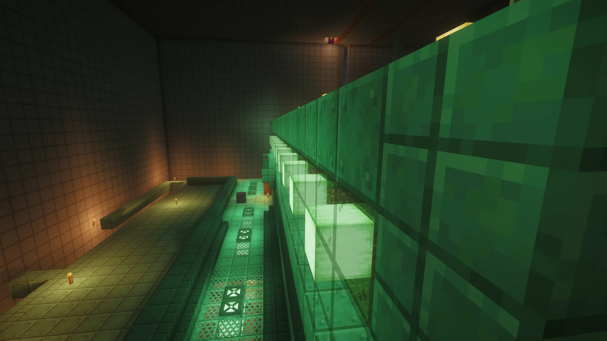
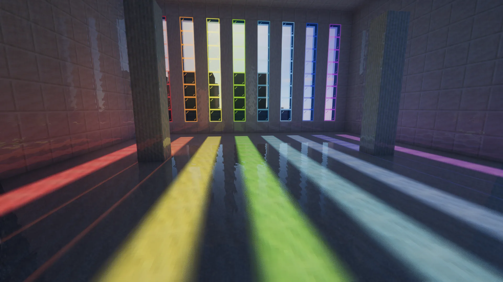

# Emberlight

Iris and OptiFine shader packs on Minecraft's Vulkan renderer, with optional hardware ray tracing.


[](https://modrinth.com/mod/emberlight/versions?l=fabric) &nbsp;&nbsp; [](https://modrinth.com/mod/emberlight/versions?l=neoforge)

---

## About Emberlight

Minecraft 26.3 can render with Vulkan, but Iris only works on OpenGL. Emberlight fills that gap. It converts a shader pack
once into Vulkan shaders, caches the result and renders it through Minecraft's own Vulkan backend. Every pipeline is built
while the pack loads, so there is no shader stutter in game. On top of the pack you can turn on ray-traced lighting,
DLSS, FSR or XeSS upscaling and frame generation. Client-side only.

**This is an alpha.** Expect bugs and keep backups of your worlds. It has been tested on one machine so far
(NVIDIA RTX 4070 Ti, Linux).

---

## Features

### Your shader packs, on Vulkan

Put packs into `shaderpacks/` as you would for Iris and press **O**. Pack options, profiles and Iris settings files work as
they are and stay compatible with Iris. The first load converts the pack in a few seconds; after that it comes from the
cache.


### Hardware ray tracing

For Complementary Reimagined and Unbound, rays replace the parts the pack has to guess: sun shadows, reflections,
refraction and water caustics, ambient occlusion, shadows from torches and lamps, and one bounce of global illumination.
It traces with Vulkan ray queries on the RT cores. Off by default; presets from Low to Ultra, and every effect has its own
switch.


### Light from every block

In the RTX style, torches, lanterns, lava, froglights and glowing ores are real light sources. They cast soft shadows,
bounce light off walls and colour the room around them. Light through stained glass is tinted.

 &nbsp;&nbsp; 

### Water and reflections

Reflections hit the real world, including blocks that are off screen. Water and glass bend the view, and caustics follow
the real water depth.


### Upscaling and frame generation

AMD FSR 3.1 and NVIDIA DLSS upscale the image, from Native AA / DLAA down to Ultra Performance. DLSS Ray
Reconstruction denoises the ray-traced image. Frame generation with FSR 3 or DLSS doubles the shown frame rate, and NVIDIA
Reflex keeps the latency down. Intel XeSS is there for Windows but not tested yet. All of it also works without a shader
pack.

### Emberlight RTX (Preview)

A shader pack written for Emberlight's own pack format and built around ray tracing from the start: ray-traced global
illumination, block lights as area lights, glossy reflections and mirrors, a physical sky and volumetric fog. With the
optional *Emberlight PBR* resource pack, concrete turns into tinted mirrors and terracotta glows like neon. Early preview,
tested on NVIDIA only.




### Photo mode

Freezes the world, renders the same view up to 256 times and saves the average: a noise-free screenshot, optionally at
twice the window resolution. Start it from the shader pack screen or with `/emberlight photo`.

### Made for playing

Packs are converted once and cached; other dimensions are compiled in the background, so changing worlds does not hitch.
A failing shader is reported in chat with file and line instead of crashing the game. Mods that ask the Iris API whether
shaders are on (Entity Model Features, Entity Texture Features) see Emberlight's packs.

---

## Shader Packs

Many Iris packs run. The table lists what has been checked in game, most against Iris on OpenGL with the same world and
camera. Ray tracing needs a patch table per pack and is only available for Complementary so far.

| Shader pack | Runs | Ray tracing | Notes |
|---|---|---|---|
| Complementary Unbound / Reimagined r5.10 (+ Euphoria Patches) | ✅ | ✅ | Current target; Reimagined r5.10 not tested yet |
| Complementary Unbound / Reimagined r5.9.3 (+ Euphoria Patches) | ✅ | ✅ | Matches Iris |
| BSL v10 | ✅ | – | Matches Iris |
| Photon v1.4 | ✅ | – | Matches Iris |
| Bliss v2.1 (Chocapic13 edit) | ✅ | – | Matches Iris |
| Eclipse | ✅ | – | Not in the Iris comparison yet |
| Solas, Sildur's Vibrant, MakeUp UltraFast, Kappa, Lux | ✅ | – | Match Iris |
| AstraLex, Insanity, Nostalgia, SuperDuperVanilla, VanillaPlus, RethinkingVoxels | ✅ | – | Match Iris |
| Shrimple v0.12 | 🟡 | – | Works, visible differences |

Upscaling and frame generation work with every pack. Complementary, Bliss, Eclipse and Photon hand their anti-aliasing over
to the upscaler; other packs keep their own TAA underneath it. Packs that are not listed may still work; if one fails,
chat names the shader and line.

<details>
<summary>Not supported</summary>

- Distant Horizons is not supported yet. Voxy is OpenGL only and cannot work.
- Iris and Emberlight do not run together: Emberlight runs on Vulkan, Iris on OpenGL. Install one of them.
- Mods that look for the `iris` mod id directly (Particle Rain, Litematica) do not see that shaders are on.

</details>

---

## Settings

Emberlight's own pages sit in the top left of the pack's *Shader Options* screen: **Emberlight RT**, **Performance**,
**Upscaling** and **Frame Generation**. The pack's own options and its `.txt` settings file are not touched.

### Keys

| Key | Action |
|---|---|
| O | Shader pack screen |
| R | Reload the pack |
| K | Shaders on / off |
| F7 | Profiler overlay (GPU time per pass) |
| unbound | Ray tracing on / off, photo mode |

All keys are in the *Emberlight* category of *Controls* and can be rebound.

### Config file

| Platform | Config file |
|---|---|
| Fabric / NeoForge | `config/emberlight.properties` |

The file is written by the settings pages. On the first start Emberlight picks a ray tracing preset and an upscaler for
your GPU.

<details>
<summary>Example: emberlight.properties (RTX 4070 Ti, everything on)</summary>

```properties
pack=ComplementaryUnbound_r5.10 + EuphoriaPatches_1.11.2
rt.enabled=true
rt.style=rtx
rt.shadows=full
rt.shadowRays=4
rt.shadowEntities=true
rt.reflections=true
rt.refraction=true
rt.caustics=true
rt.ao=true
rt.blockLightRays=8
rt.gi=high
rt.giCache=true
rt.omm=true
rt.distance=0
upscale.mode=dlss
upscale.preset=quality
upscale.rr=false
upscale.sharpness=0.5
framegen.mode=dlss
framegen.autoPause=false
reflex.mode=off
hdr.enabled=false
perf.shadowReceivers=all
```

</details>

---

## Requirements

Minecraft Java 26.3 with Fabric (Fabric Loader 0.20.1 or newer and Fabric API) or NeoForge. **Sodium 0.9.3-beta.5 is
required**, exactly that version: Emberlight hooks Sodium's internals, which change between betas. Set *Video Settings →
Graphics API* to *Prefer Vulkan* and restart; on OpenGL Emberlight stays inactive and tells you so.

| Feature | What you need |
|---|---|
| Shader packs, FSR, FSR frame generation | Any GPU with Vulkan |
| Ray tracing | A GPU with hardware ray tracing (`VK_KHR_ray_query`): NVIDIA RTX or AMD RX 6000 and newer. Tested on NVIDIA only |
| Emberlight RTX (Preview) | Ray tracing as above; tested on NVIDIA only |
| DLSS, DLSS Ray Reconstruction, Reflex | NVIDIA RTX |
| DLSS frame generation | NVIDIA RTX 40 series or newer |
| XeSS | Windows; not tested yet |

DLSS needs NVIDIA's model files (about 110 MB). Emberlight offers to download them from NVIDIA the first time you pick
DLSS. Ray tracing costs a lot: about 0.85 GB of extra VRAM, and up to half the frame rate with everything on. Upscaling and
frame generation make up for much of it.

---

[](https://github.com/EmrionMC/Emberlight) &nbsp;&nbsp; [](https://discord.gg/4nGrfZxb2a)

<sub>NVIDIA, NVIDIA RTX and DLSS are trademarks of NVIDIA Corporation. Not affiliated with Mojang, Microsoft, the Iris
project or the authors of the shader packs listed above.</sub>
