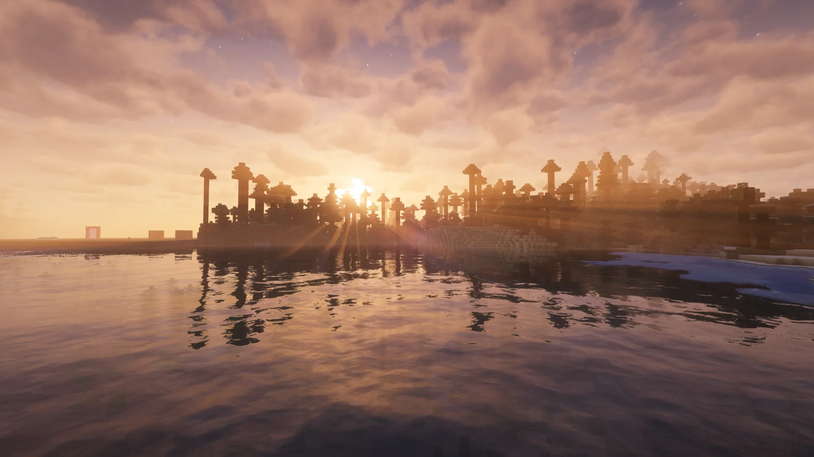
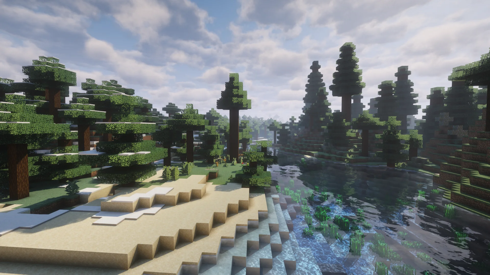
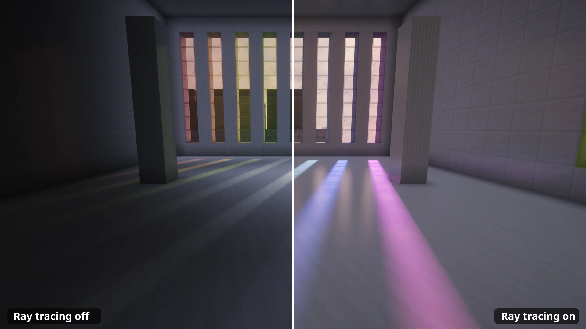
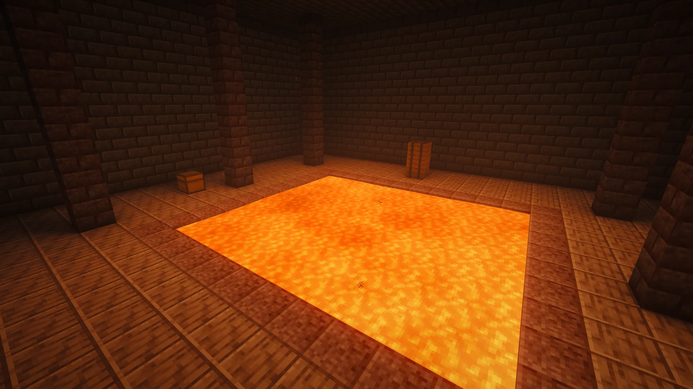
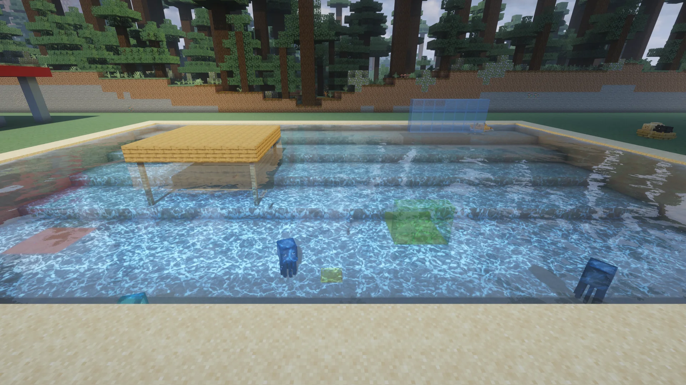
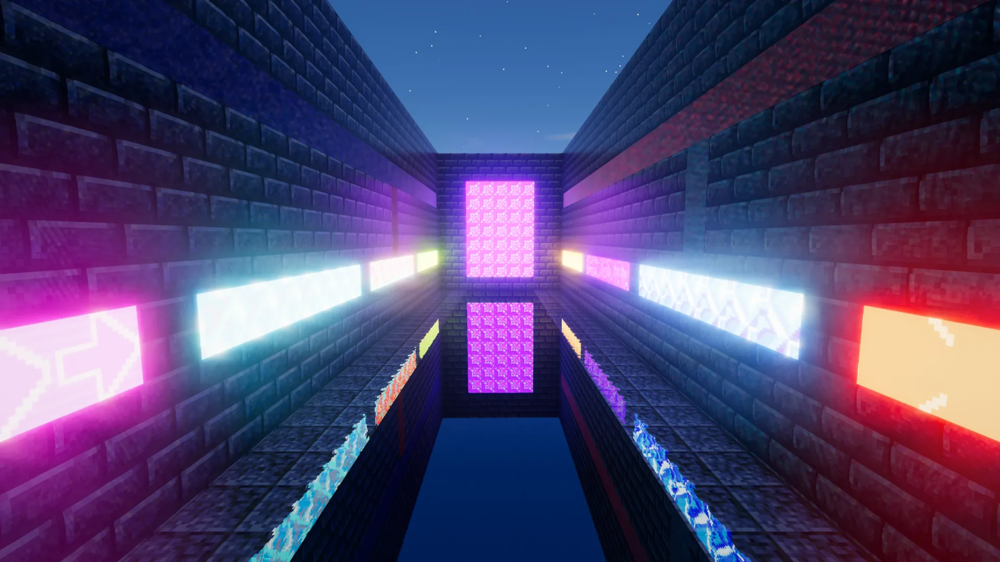

<!-- Gallery plan (existing and wanted screenshots): docs/MODRINTH-GALLERY.md. Strip all HTML comments before pasting into Modrinth. -->

# Emberlight

Iris and OptiFine shader packs on Minecraft's Vulkan renderer, with optional hardware ray tracing.



[](https://modrinth.com/mod/emberlight/versions?l=fabric) &nbsp;&nbsp; [](https://modrinth.com/mod/emberlight/versions?l=neoforge)

---

## About Emberlight

Minecraft 26.3 can render with Vulkan, but Iris only works on OpenGL. Emberlight fills that gap. It converts a shader pack
once into Vulkan shaders, caches the result and renders it through Minecraft's own Vulkan backend. Every pipeline is built
while the pack loads, so there is no shader stutter in game. On top of the pack you can turn on ray-traced lighting,
DLSS, FSR or XeSS upscaling and frame generation. Client-side only, for Fabric and NeoForge.

**This is an alpha.** Expect bugs and keep backups of your worlds. It has been tested on one machine so far
(NVIDIA RTX 4070 Ti, on Linux and Windows 11).

---

## Features

### Your shader packs, on Vulkan

Put packs into `shaderpacks/` as you would for Iris and press **O**. Pack options, profiles and Iris settings files work as
they are and stay compatible with Iris. The first load converts the pack in a few seconds; after that it comes from the
cache.



### Hardware ray tracing

A shader pack has to fake a lot: shadows come from a shadow map, reflections only show what is on screen, and indirect
light is a guess. For Complementary Reimagined and Unbound (with or without Euphoria Patches), Emberlight replaces those
parts with real rays: sun shadows, reflections, refraction and water caustics, ambient occlusion, shadows from torches and
lamps, and one bounce of global illumination. Everything else stays the pack's own look. It traces with Vulkan ray
queries on the RT cores. Off by default; presets from Low to Ultra, and every effect has its own switch.

Two styles: *RTX* lets the rays light the scene (coloured light through stained glass, bounced light, glossy metal),
*Faithful* only makes the pack's own effects more accurate.



### Light from every block

In the RTX style, torches, lanterns, lava, froglights and glowing ores are real light sources. They cast soft shadows,
bounce light off walls and colour the room around them. Light through stained glass is tinted.

 &nbsp;&nbsp; 

### Water and reflections

Reflections hit the real world, including blocks that are off screen. Water and glass bend the view, and caustics follow
the real water depth.



### Upscaling and frame generation

AMD FSR 3.1, NVIDIA DLSS and Intel XeSS upscale the image, from Native AA / DLAA down to Ultra Performance. DLSS Ray
Reconstruction denoises the ray-traced image. Frame generation with FSR 3 or DLSS doubles the shown frame rate, and NVIDIA
Reflex keeps the latency down. DLSS (Super Resolution, Ray Reconstruction, Frame Generation) runs on Linux and Windows;
XeSS is Windows only, because Intel ships no Linux runtime. All of it also works without a shader pack.

### Emberlight RTX (Preview)

A shader pack written for Emberlight's own pack format and built around ray tracing from the start: ray-traced global
illumination, block lights as area lights, glossy reflections and mirrors, a physical sky and volumetric fog. With the
optional *Emberlight PBR* resource pack, concrete turns into tinted mirrors and terracotta glows like neon. Early preview,
tested on NVIDIA only.




### Photo mode

Freezes the world, renders the same view up to 256 times and saves the average: a noise-free screenshot, optionally at
twice the window resolution. Start it from the shader pack screen or with `/emberlight photo`.

### Made for playing

Packs are converted once and cached; other dimensions are compiled in the background, so changing worlds does not hitch.
A failing shader is reported in chat with file and line instead of crashing the game.

### Plays well with other mods

- **Sodium** draws the terrain, as under Iris.
- **Better Block Entities**: its meshed chests, signs and banners render correctly under a pack, with ray tracing too.
- **VoxelMap**: waypoint beams are hidden behind blocks again, as with Iris.
- Mods that ask the Iris API whether shaders are on (Entity Model Features, Entity Texture Features) see Emberlight's
  packs.

---

## Shader Packs

Many Iris packs run. The table lists what has been checked in game, most against Iris on OpenGL with the same world and
camera. Ray tracing needs a patch table per pack and is only available for Complementary so far.

| Shader pack | Runs | Ray tracing | Notes |
|---|---|---|---|
| Complementary Unbound / Reimagined r5.10 (+ Euphoria Patches 1.11.2) | ✅ | ✅ | Recommended, full RT integration |
| Complementary Unbound / Reimagined r5.9.3 (+ Euphoria Patches) | ✅ | ✅ | Older version, still loads; new work goes into r5.10 |
| BSL v10 | ✅ | – | Matches Iris |
| Photon v1.4 | ✅ | – | Matches Iris |
| Bliss v2.1 (Chocapic13 edit) | ✅ | – | Matches Iris |
| Eclipse | ✅ | – | Not in the Iris comparison yet |
| Solas, Sildur's Vibrant, MakeUp UltraFast, Kappa, Lux | ✅ | – | Match Iris |
| AstraLex, Insanity, Nostalgia, SuperDuperVanilla, VanillaPlus, RethinkingVoxels | ✅ | – | Match Iris |
| Shrimple v0.12 | 🟡 | – | Works, visible differences |

Upscaling and frame generation work with every pack. Complementary, Bliss, Eclipse and Photon hand their anti-aliasing over
to the upscaler; other packs keep their own TAA underneath it. Packs that are not listed may still work; if one fails,
chat names the shader and line.

<details>
<summary>Not supported</summary>

- Distant Horizons is not supported yet. Voxy is OpenGL only and cannot work.
- Iris and Emberlight do not run together: Emberlight runs on Vulkan, Iris on OpenGL. Install one of them.
- Mods that look for the `iris` mod id directly (Particle Rain, Litematica) do not see that shaders are on.

</details>

---

## Settings

Emberlight's own pages sit in the top left of the pack's *Shader Options* screen: **Emberlight RT**, **Performance**,
**Upscaling** and **Frame Generation**. The pack's own options and its `.txt` settings file are not touched.

### Keys

| Key | Action |
|---|---|
| O | Shader pack screen |
| R | Reload the pack |
| K | Shaders on / off |
| F7 | Profiler overlay (GPU time per pass) |
| unbound | Ray tracing on / off, photo mode |

All keys are in the *Emberlight* category of *Controls* and can be rebound.

### Config file

| Platform | Config file |
|---|---|
| Fabric / NeoForge | `config/emberlight.properties` |

The file is written by the settings pages. On the first start Emberlight picks a ray tracing preset and an upscaler for
your GPU.

<details>
<summary>Example: emberlight.properties (RTX 4070 Ti, everything on)</summary>

```properties
pack=ComplementaryUnbound_r5.10 + EuphoriaPatches_1.11.2
rt.enabled=true
rt.style=rtx
rt.shadows=full
rt.shadowRays=4
rt.shadowEntities=true
rt.reflections=true
rt.refraction=true
rt.caustics=true
rt.ao=true
rt.blockLightRays=8
rt.gi=high
rt.giCache=true
rt.omm=true
rt.distance=0
upscale.mode=dlss
upscale.preset=quality
upscale.rr=false
upscale.sharpness=0.5
framegen.mode=dlss
framegen.autoPause=false
reflex.mode=off
hdr.enabled=false
perf.shadowReceivers=all
```

</details>

---

## Installation

1. Install Fabric (Fabric Loader 0.20.1 or newer and Fabric API) or NeoForge for Minecraft Java 26.3.
2. Put the Emberlight jar for your loader into `mods/`: `emberlight-fabric-<version>.jar` or
   `emberlight-neoforge-<version>.jar`.
3. Add **Sodium 0.9.4-beta.2** for the same loader, exactly that version: Emberlight hooks Sodium's internals, which
   change between versions. If Fabric says *"Incompatible mods found … Emberlight … Sodium"*, your Sodium is the wrong
   version; swap Sodium, not Emberlight.
4. Set *Video Settings → Graphics API* to *Prefer Vulkan* and restart. On OpenGL Emberlight stays inactive and tells you so.
5. Put shader packs into `shaderpacks/`, press **O** and pick one.

## Requirements

| Feature | What you need |
|---|---|
| Shader packs, FSR, FSR frame generation | Any GPU with Vulkan |
| Ray tracing | A GPU with hardware ray tracing (`VK_KHR_ray_query`): NVIDIA RTX or AMD RX 6000 and newer. Tested on NVIDIA only |
| Emberlight RTX (Preview) | Ray tracing as above; tested on NVIDIA only |
| DLSS, DLSS Ray Reconstruction, Reflex | NVIDIA RTX, Linux or Windows |
| DLSS frame generation | NVIDIA RTX 40 series or newer |
| XeSS | Windows, any GPU with DP4a |

DLSS needs NVIDIA's model files (about 110 MB). Emberlight offers to download them from NVIDIA the first time you pick
DLSS (XeSS works the same way with Intel's runtime, about 77 MB). Ray tracing costs a lot: about 0.85 GB of extra VRAM,
and up to half the frame rate with everything on. Upscaling and frame generation make up for much of it.

---

## Known limitations

- Alpha software, tested on one machine (RTX 4070 Ti). AMD and Intel GPUs are untested.
- Ray tracing only works with Complementary packs so far; other packs need their own patch table.
- Distant Horizons is not supported yet; Voxy is OpenGL only and cannot work.
- Reflections on water, moving mobs and the hand have no motion vectors yet, so they can smear a little with upscaling
  or frame generation while the camera moves.
- 256× PBR resource packs need a lot of VRAM together with Complementary's voxel data, as with Iris.
- Frame generation pauses itself when the game already reaches your monitor's refresh rate, since the extra frames could
  not be shown. You can turn the auto pause off on the Frame Generation page.
- Euphoria Patcher logs *"No shader loader mod was found"* because it only looks for Iris and OptiFine. It still patches
  the pack; the message is harmless.
- Vanilla 26.3 also binds **O** to *Friends*. Both fire; rebind one of them if it bothers you.

---

## FAQ

**Is this ray tracing or path tracing?**
Hybrid ray tracing. The pack still rasterises the scene and does its own lighting; rays replace the parts where it has to
guess. Emberlight RTX goes further and lights most of the scene with rays.

**Materials look flat and matte with ray tracing.**
Complementary's *LabPBR* material mode expects a PBR resource pack. Without one every block is treated as rough. Switch
the pack's material option to *Integrated PBR*, or add a LabPBR resource pack.

**Why does DLSS want to download something?**
NVIDIA's DLSS model files are under NVIDIA's own licence, so they are not in the jar. The first time you pick DLSS, Emberlight offers a
one-time download straight from NVIDIA's GitHub (pinned version, checked by hash). Restart once, then DLSS can be
switched on and off live.

**Can I use it together with Iris?**
No, install one or the other. Emberlight runs on Vulkan, Iris on OpenGL.

**Does it work with AMD or Intel GPUs?**
Shader packs, FSR and FSR frame generation should work on any Vulkan GPU, and ray tracing on any GPU with hardware ray
tracing. So far it has only been tested on NVIDIA, so reports are very welcome.

**Fabric or NeoForge?**
Both get the same features. Pick the jar that matches your loader and Sodium's build for the same loader.

**Where is the cache? Can I delete it?**
`emberlight/cache/` in your game folder. Yes; packs are converted again on the next load.

---

## Downloads

<!-- TODO: decide how Emberlight RTX and Emberlight PBR are distributed before publishing. Today neither is in the
mod jar: Emberlight RTX is the folder packs/emberlight-rtx (zip it), Emberlight PBR is built by
packs/emberlight-pbr/tools/generate.py. Options: GitHub release assets, separate Modrinth projects (shader + resource
pack; Modrinth "shader" projects are for Iris/OptiFine loaders, so check how a native Emberlight pack would be tagged),
or bundled in the mod jar. Replace the paragraph below with the real links. -->

- **Emberlight**: the *Versions* tab, one jar per loader.
- **Emberlight RTX** (shader pack) and **Emberlight PBR** (resource pack): download links will follow here. Until then
  they are in the [GitHub repository](https://github.com/EmrionMC/Emberlight) under `packs/`.
- **Complementary** and **Euphoria Patches**: from their own Modrinth pages. Emberlight does not ship or modify the
  pack files; the ray tracing patches are applied in memory when the pack loads.

---

## Credits

- **Complementary Shaders** by EminGT: the ray tracing is built around Complementary Reimagined and Unbound, with
  EminGT's permission. Ray tracing is optional and off by default; without it, Complementary looks as he designed it.
- **Euphoria Patches** by SpacEagle17: RT integration with his approval.
- **Iris**, used as the specification for the shader pack format. No Iris code is included apart from Iris's public API
  classes (LGPL-3.0).
- **AMD FidelityFX FSR** (MIT), **NVIDIA DLSS** and **Intel XeSS** for upscaling and frame generation.

---

## How Emberlight is made

I started Emberlight and I'm the one behind it. I use AI coding assistants (Claude and Codex) heavily for writing code,
and I'm open about that. I read and understand what goes in, decide how things are built, and test every change in game
myself before it ships. If something is broken, that's on me: tell me on Discord or GitHub.

<!-- TODO: read this in your own voice and adjust; README's "Development" section says the same in one line. -->

---

[](https://github.com/EmrionMC/Emberlight) &nbsp;&nbsp; [](https://discord.gg/4nGrfZxb2a)

<sub>NVIDIA, NVIDIA RTX and DLSS are trademarks of NVIDIA Corporation. Not affiliated with Mojang, Microsoft, the Iris
project or the authors of the shader packs listed above.</sub>
